<div align="center">

# 🔥 ImpactForge

### The AI-Powered Student Philanthropy Engine

**One sentence in. A fully designed fundraising campaign out. Then every donor gets a Wrapped-style story of exactly where their money went.**

[](LICENSE)
[](https://hacktoberfest.com)
[](https://nextjs.org)
[](https://www.typescriptlang.org)
[](https://github.com/your-username/impactforge/actions/workflows/ci.yml)
[](CONTRIBUTING.md)

[**🚀 Live Demo**](https://impactforge.vercel.app) · [**🎁 Impact Wrapped demo**](https://impactforge.vercel.app/impact/demo) · [**🐛 Report a bug**](../../issues/new?template=bug_report.md) · [**✨ Request a feature**](../../issues/new?template=feature_request.md)

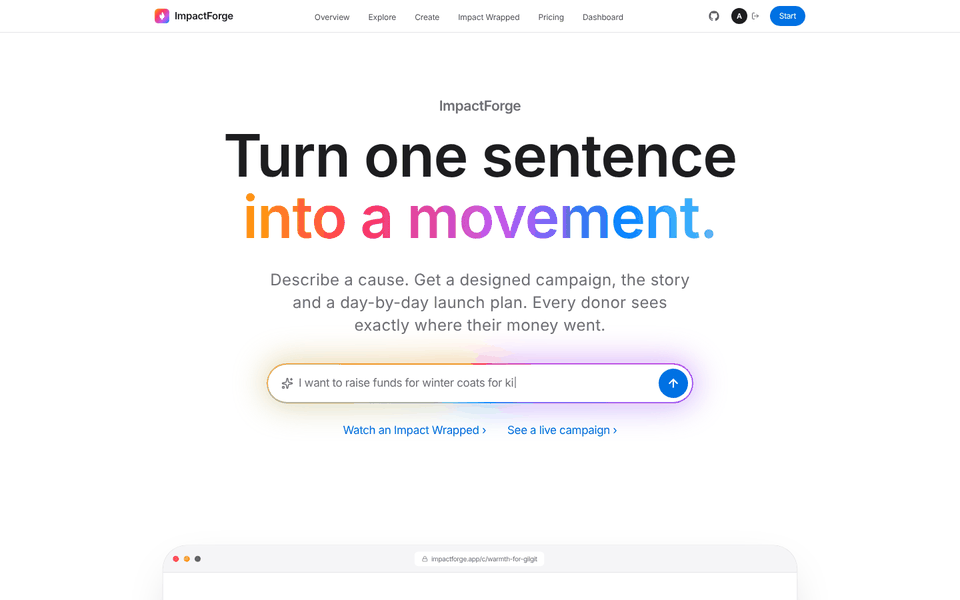

_Built for **Hacktoberfest NUST × NSTP 2026** with [Kiro](https://kiro.dev)._

</div>

---

## 💡 The problem

Campus charity drives run on WhatsApp forwards and Google Forms. Organizers lose days writing copy, designing posters and planning outreach, and donors almost never learn what their money actually did. **Low trust leads to low repeat giving.**

## ✨ The solution

| | Feature | What it does |
|---|---|---|
| 🧠 | **Campaign-in-a-Box** | Type _"I want to raise funds for winter coats"_. Two AI calls run in parallel and return a **themed landing page**: story, impact tiers (_PKR 2,500 = 1 coat_), a transparent budget, FAQs, a WhatsApp pitch and a **day-by-day launch plan** with channels and KPIs. |
| 🎁 | **Impact Wrapped** | A cinematic, swipeable 7-slide story for every donor: a **Sankey** of where each rupee went, an animated **node graph** linking donor → campaign → beneficiaries, ripple effects, a delivery journey and an exportable share card. |
| 💸 | **One-tap giving** | A polished donation flow that translates amounts into real outcomes, with a celebratory confetti finish. _(Payments are simulated.)_ |
| 🎬 | **Generation Theater** | While Claude works, you watch the campaign page assemble itself: skeletons per step, then the real title, palette and cover art snap in. |
| 🎨 | **Generative cover art** | Every campaign gets a unique poster built from its id, palette and hero style: mesh light, pattern, grain and an icon medallion. No stock photos. |
| 🌍 | **Campus-to-valley globe** | A live WebGL globe shows donation flows from NUST, Islamabad to Gilgit, Skardu, Tharparkar, Dadu and Kech. |
| 💳 | **Real checkout** | Optional tip, fee cover (the cause nets 100%), monthly giving, sponsor matching and an itemized total. Stripe Checkout when configured, demo mode otherwise. |
| 🧾 | **Receipts** | A printable, itemized receipt for every gift, with the budget allocation. |
| 🔎 | **Explore** | Search, filter by cause, and sort by trending, most funded or newest. |
| 📊 | **Organizer dashboard** | Raised over time, visitors-to-donors funnel, CSV export, plan usage, and a platform-revenue view. |
| ✏️ | **Edit, rewrite, undo** | Organizers edit any AI copy, regenerate with AI (Pro) and undo the rewrite. |

## 🖼️ Screenshots

| Landing | Generation Theater | Generated campaign |
|---|---|---|
| 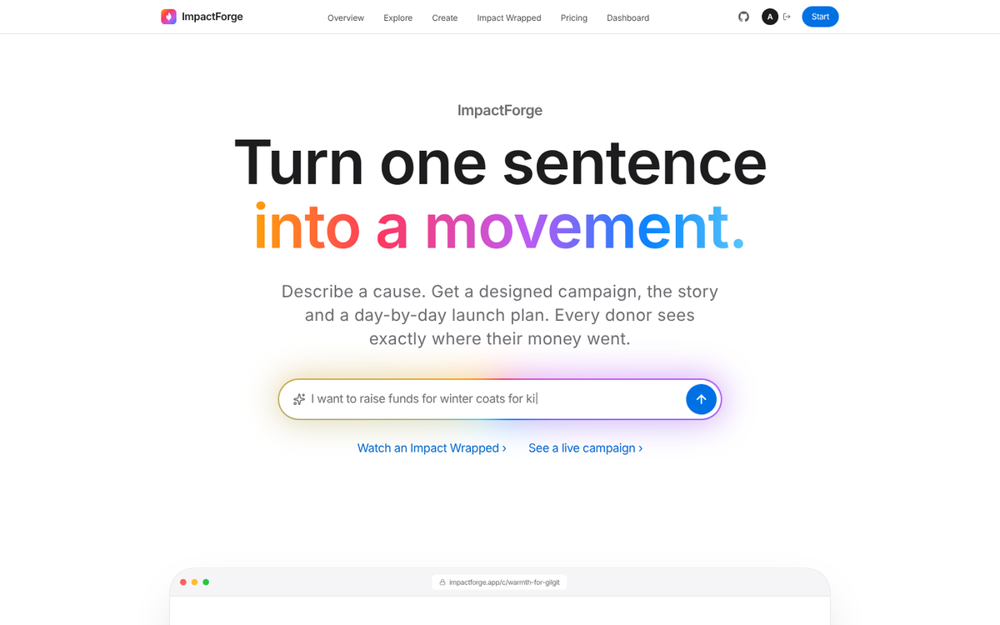 | 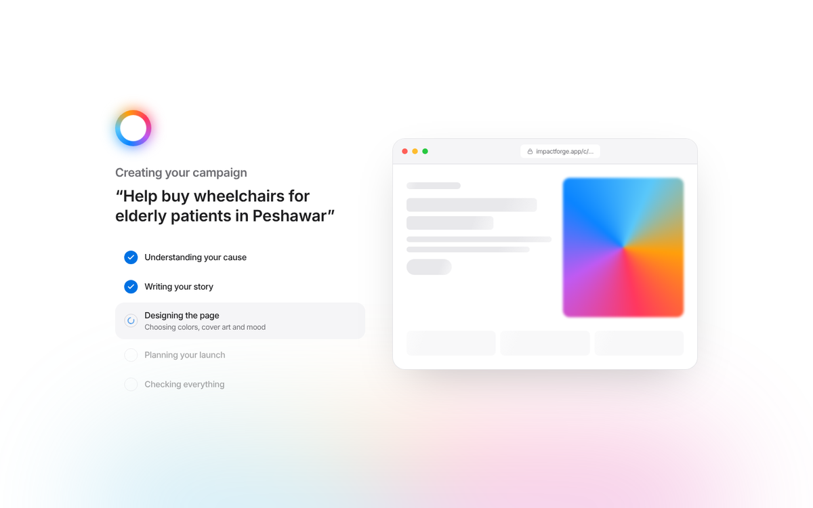 | 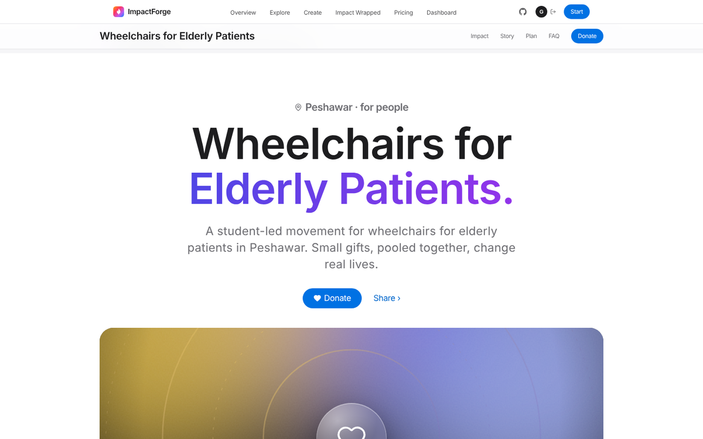 |

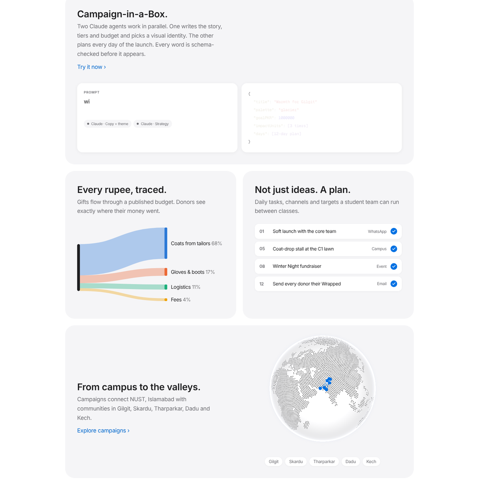

| Checkout | Receipt | Impact Wrapped |
|---|---|---|
| 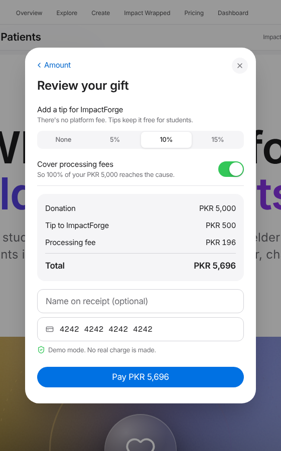 | 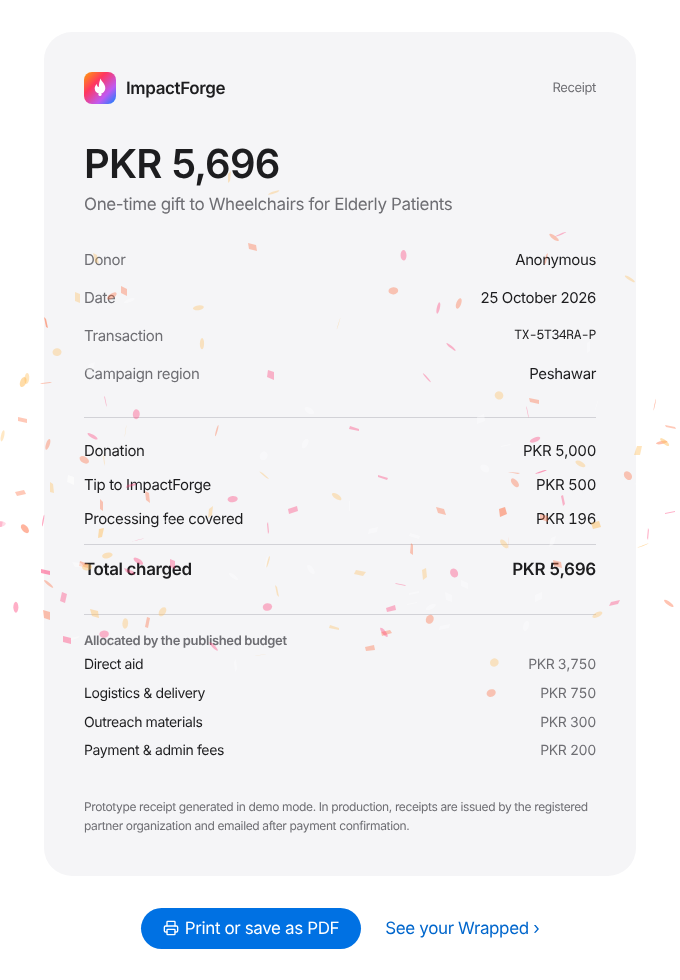 | 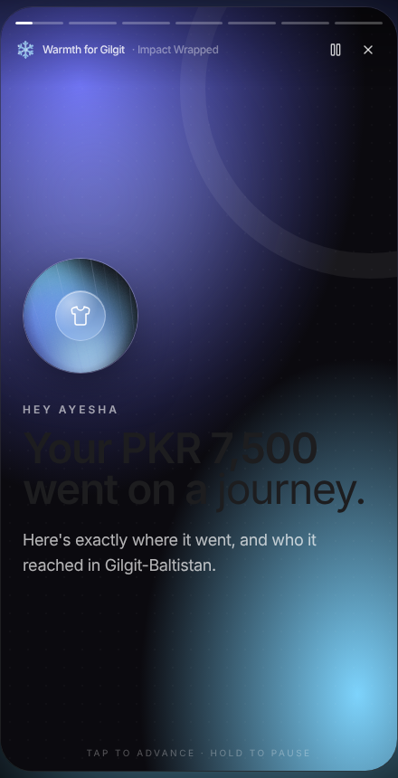 |

| Pricing | Dashboard |
|---|---|
| 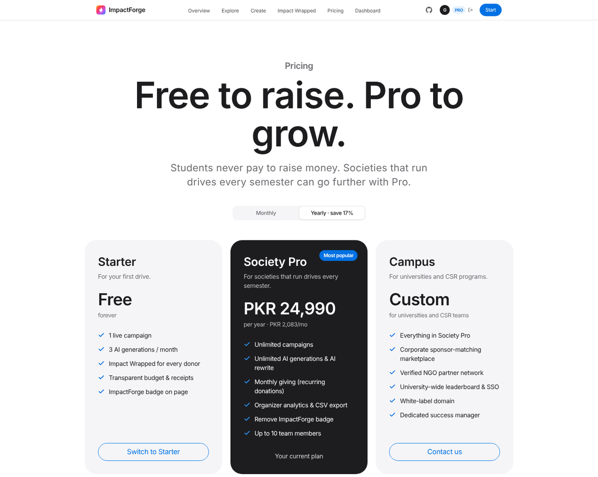 | 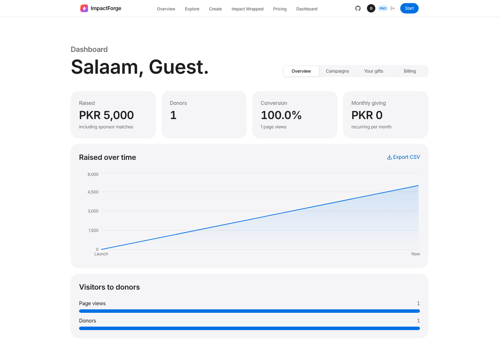 |

## 🏗️ Architecture

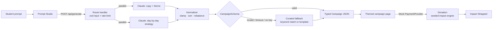

### Design system: Apple's design language

Built against the principles of Apple's Human Interface Guidelines (purpose, simplicity, craft, accessibility):

- **Light canvas, system type.** SF Pro on Apple devices (Inter fallback), `#f5f5f7` tiles, Apple-blue pill CTAs, a frosted 48px global nav and a sticky per-campaign sub-nav.
- **One signature element.** The Intelligence glow is reserved for AI moments: the prompt and the Generation Theater. Everything else stays quiet.
- **Identity in the content layer.** Each campaign's palette lives in its generative cover art and title gradient, not in the chrome.
- **Accessible by default.** Secondary text at 5.0:1 (never `#86868b` for small text), 44px touch targets, labeled icon buttons, light and dark appearance following the system, and support for `prefers-reduced-motion`, `prefers-reduced-transparency` and `prefers-contrast`.
- **Sheets, not pages, for one-task flows.** Donate and upgrade are bottom sheets with a grabber, drag-to-dismiss, Escape and an explicit close.

### Engineering decisions

- **The LLM returns data, never markup.** Generation uses Anthropic structured outputs (`messages.parse` + `zodOutputFormat`). Output is then **normalized** (goal clamped, tiers sorted, budget rebalanced to exactly 100% by largest remainder, days renumbered) and **validated** by a strict Zod schema before it renders. There's no HTML injection path.
- **Two-layer schemas.** A loose AI-facing schema (structure, enums, descriptions) feeds a strict app schema, so model drift gets repaired rather than crashing the page.
- **Constrained creativity.** The model picks from curated design tokens (6 palettes × 4 hero backgrounds × 4 moods). Every campaign looks unique and none looks broken.
- **Parallel generation.** Copy and strategy are generated concurrently, roughly halving latency.
- **The demo can't fail.** No API key, `DEMO_MODE`, a timeout (AbortController) or an unrepairable response all fall back to curated, keyword-matched campaigns, or a template built from the prompt's own words (`"wheelchairs for elderly patients in Peshawar"` → _"Wheelchairs for Elderly Patients"_, region _Peshawar_).
- **Deterministic impact data.** Wrapped stories come from a seeded PRNG keyed by donation id, so the same donation always tells the same story. Allocation follows the published budget and sums exactly to the gift.
- **Swappable mocks.** Payments sit behind a `PaymentProvider` interface (Luhn-checked locally, nothing transmitted). Auth and persistence live in one Zustand store, so Stripe, NextAuth or Postgres can replace them without UI changes.
- **Accessible data viz.** Chart colors use a fixed, colorblind-validated palette (checked for CVD separation and ≥ 3:1 contrast on the dark surface), always paired with direct labels. Motion respects `prefers-reduced-motion`.
- **Modern Next.js.** App Router on Next.js 16 with Cache Components. Curated campaigns are prerendered with `generateStaticParams`, and generated ones stream in behind `<Suspense>`.

## 💰 Business model

ImpactForge is free for students and sustainable without a platform fee:

| Stream | How it works | Where in code |
|---|---|---|
| Donor tips | Optional 0/5/10/15% tip at checkout (default 10%) | `computeCheckout` in `src/lib/monetization.ts` |
| Society Pro | PKR 2,499/mo or PKR 24,990/yr: unlimited campaigns, AI rewrite, monthly giving, analytics, CSV, no badge | `PLANS`, `UpsellSheet`, plan gating in studio and dashboard |
| Campus | Custom: sponsor-matching marketplace, verified NGOs, SSO, white-label | `/pricing#campus` |
| Sponsor listing fee | 5% of matched funds, paid by the sponsor | `matchFor`, `platformRevenue` |

Donors can **cover the processing fee** (grossed up so the cause nets exactly 100%). The server recomputes every amount, and the pricing page's calculator uses the same function as checkout. The dashboard's **Billing** tab shows plan usage and a platform-revenue roll-up (tips, sponsor fees, subscription MRR, GMV, take rate).

### Payments

| Mode | When | Behavior |
|---|---|---|
| Demo | No `STRIPE_SECRET_KEY` | Instant mock receipt, clearly labeled. No card data leaves the browser. |
| Stripe | `STRIPE_SECRET_KEY` set | Hosted Stripe Checkout (one-time or monthly), confirmed server-side at `/checkout/success`. Webhooks verified at `/api/webhooks/stripe` (HMAC, 5-minute replay window). |

Stripe doesn't onboard Pakistani merchants directly; it's the reference implementation. A PayFast, JazzCash or Easypaisa provider implements the same server interface.

## 🧰 Tech stack

| Layer | Tools |
|---|---|
| Framework | Next.js 16 (App Router, Cache Components), React 19, TypeScript (strict) |
| Styling | Tailwind CSS v4, CSS-variable theme tokens |
| Motion & UI | Motion (Framer Motion), custom Aceternity/Magic-UI-style components, canvas ember particles, [cobe](https://github.com/shuding/cobe) WebGL globe |
| Typography | System SF Pro (Inter fallback), Geist Mono for code |
| Payments | Stripe Checkout over REST (no SDK), HMAC-verified webhooks, demo fallback |
| Data viz | Recharts (donut, Sankey), hand-built animated SVG node graph |
| AI | Anthropic Claude API (structured outputs), Zod |
| State | Zustand + localStorage persistence |
| Quality | ESLint, Prettier, `node:test` unit tests, GitHub Actions CI |
| Workflow | **Kiro**: spec-driven development, steering, agent hooks |

## 🚀 Getting started

**Prerequisites:** Node.js 20+. An [Anthropic API key](https://console.anthropic.com) is optional; without one the app runs in offline demo mode.

```bash
git clone https://github.com/your-username/impactforge.git
cd impactforge
npm install
cp .env.example .env.local   # add ANTHROPIC_API_KEY for live AI (optional)
npm run dev
```

Open [http://localhost:3000](http://localhost:3000), type a cause, and hit **Forge campaign**.

### Environment variables

| Variable | Default | Description |
|---|---|---|
| `ANTHROPIC_API_KEY` | (none) | Enables live AI generation |
| `AI_MODEL` | `claude-haiku-5-5` | Generation model (try `claude-sonnet-5-5` for richer copy) |
| `AI_TIMEOUT_MS` | `25000` | Abort and fall back after this long |
| `DEMO_MODE` | `false` | Force curated campaigns (handy on flaky venue Wi-Fi) |
| `NEXT_PUBLIC_REPO_URL` | (none) | GitHub link shown in the navbar |
| `STRIPE_SECRET_KEY` | (none) | Enables real Stripe Checkout; demo mode without it |
| `STRIPE_WEBHOOK_SECRET` | (none) | Verifies `/api/webhooks/stripe` events |
| `STRIPE_CURRENCY` | `pkr` | Checkout currency |

### Scripts

```bash
npm run dev           # dev server
npm run build         # production build
npm run lint          # ESLint
npm run typecheck     # route typegen + tsc --noEmit
npm test              # unit tests (normalizer, fallback, impact engine, checkout math, Stripe signatures)
npm run format        # Prettier
```

### Deploy

One click on [Vercel](https://vercel.com/new): import the repo and optionally add `ANTHROPIC_API_KEY`. No database needed.

## 📁 Project structure

```
src/
├── app/
│   ├── page.tsx                  # landing
│   ├── create/                   # Prompt Studio
│   ├── c/[slug]/                 # generated campaign page
│   ├── impact/[donationId]/      # Impact Wrapped (try /impact/demo)
│   ├── dashboard/                # analytics, campaigns, gifts, billing
│   ├── pricing/ explore/         # plans + calculator · search & filters
│   ├── receipt/[donationId]/     # printable receipt
│   ├── checkout/success/         # Stripe return URL
│   └── api/                      # generate · checkout · checkout/verify · webhooks/stripe
├── components/
│   ├── ui/                       # backgrounds, ShimmerButton, NumberTicker, GlowCard, ProgressRing…
│   ├── studio/                   # PromptStudio, GenerationTheater
│   ├── campaign/                 # CampaignView, DonateDialog, BudgetDonut, StrategyTimeline, Dashboard
│   └── wrapped/                  # WrappedStory engine + 7 slides
├── lib/
│   ├── monetization.ts           # plans, checkout math, sponsor matching, revenue
│   ├── payments/                 # Stripe client, browser checkout, mock provider
│   ├── schema.ts                 # every Zod schema & type
│   ├── normalize.ts              # AI output → strict Campaign
│   ├── themes.ts                 # palette tokens + validated chart palette
│   ├── ai/                       # client, prompts, fallback
│   └── mock/                     # payments, deterministic impact engine
├── store/useAppStore.ts          # mock auth + persistence
└── data/campaigns/               # curated campaigns (validated at build time)
tests/                            # node:test suites
.kiro/                            # steering, specs & hooks used to build this
```

## 🤖 Built with Kiro

The project was built spec-first in the **Kiro IDE**. Everything is in [`.kiro/`](.kiro):

- **Steering** ([`.kiro/steering`](.kiro/steering)): always-on rules for product scope, tech constraints, structure, and a design system (theme tokens, motion budget, mobile-first).
- **Specs** ([`.kiro/specs`](.kiro/specs)): EARS-format requirements, design docs and task lists for **Campaign-in-a-Box**, **Impact Wrapped** and **Monetization & payments**.
- **Hooks** ([`.kiro/hooks`](.kiro/hooks)):
  - `seed-schema-guard`: when the schema or seed JSON changes, re-validates every fallback campaign so the offline demo can't break.
  - `theme-token-lint`: flags hardcoded campaign colors and motion that ignores reduced-motion.
  - `ship-check`: a one-click pre-demo lint, typecheck, test and build.

## ⚠️ Prototype scope & mocks

This is a hackathon prototype focused on a flawless happy path. These parts are **intentionally simulated**:

| Area | Prototype | Production path |
|---|---|---|
| Authentication | One-click "Login as Guest" | NextAuth / Clerk |
| Payments | Demo checkout by default; real Stripe Checkout when keys are set | PayFast / JazzCash / Easypaisa provider |
| Persistence | localStorage + curated JSON | Postgres (Supabase / Neon) |
| Impact data | Deterministic mock (seeded by donation id) | NGO partner reports & receipts |

**No real money moves, and no personal data leaves your browser.** Beneficiary names in Wrapped stories are illustrative.

## 🗺️ Roadmap

- [x] Stripe Checkout + webhooks (reference provider)
- [ ] PayFast / JazzCash / Easypaisa provider
- [ ] NGO verification and receipt uploads feeding real Wrapped data
- [ ] Stream generation token-by-token into the Generation Theater
- [ ] AI-generated social assets (Instagram stories, posters)
- [ ] Urdu / English bilingual campaigns
- [ ] Public campaign discovery feed and shareable campaign URLs (server persistence)

See [open issues](../../issues), especially those labelled `good first issue` and `hacktoberfest`.

## 🤝 Contributing

Contributions are welcome. Please read [CONTRIBUTING.md](CONTRIBUTING.md) and our [Code of Conduct](CODE_OF_CONDUCT.md).

1. Fork the repo and create a branch: `git checkout -b feat/amazing-feature`
2. Make sure `npm run lint && npm run typecheck && npm test && npm run build` pass
3. Commit with [Conventional Commits](https://www.conventionalcommits.org): `feat: add urdu copy generation`
4. Open a pull request

Security issues: see [SECURITY.md](SECURITY.md).

## 📄 License

Distributed under the **MIT License**. See [`LICENSE`](LICENSE).

Third-party packages remain under their own licenses. See [`THIRD_PARTY_NOTICES.md`](THIRD_PARTY_NOTICES.md).

## 🙏 Acknowledgments

- [Hacktoberfest](https://hacktoberfest.com), **NUST** and **NSTP** for hosting
- [Kiro](https://kiro.dev) for spec-driven AI development
- [Anthropic](https://www.anthropic.com) for Claude
- [Aceternity UI](https://ui.aceternity.com) and [Magic UI](https://magicui.design) for visual inspiration
- [Recharts](https://recharts.org), [Motion](https://motion.dev), [Zustand](https://zustand.docs.pmnd.rs), [Zod](https://zod.dev)

## 👥 Team

| Name | Role | GitHub |
|---|---|---|
| _Your name_ | Full-stack & AI | [@your-handle](https://github.com/your-handle) |
| _Teammate_ | UI/UX & motion | [@handle](https://github.com/handle) |

<div align="center">

**If ImpactForge made you smile, please ⭐ the repo. It helps more students find it.**

</div>
